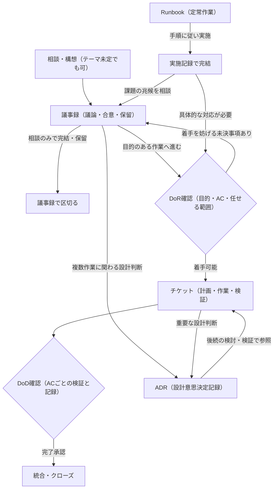

# 02. 用語と全体像

## 概要

AIcoを利用・検討・設計するすべての人とAIが、同じ意味で語彙を使い、共通の地図として参照できるようにする。
本章では以下を定める。

* **文書と資材の3層構造**：ポリシー・仕様・テンプレートの線引き
* **仕事の流れと4種の管理情報**：相談・チケット・Runbook・ADRの俯瞰図
* **基本用語**：DoR・AC・DoD・ADRの定義
* **用語の統制**：類似語の採用方針と使い分け

具体的なファイル配置や詳細な手順は、後続の `03. 情報管理方針` および `04. プロセス定義` に譲る。

## 1. 文書と資材の3層構造

AIcoの設計と配布物は、責任範囲の混在を防ぐため以下の3層に分ける。

| 層 | 目的 | 記載する範囲 | 記載しない範囲 |
| :--- | :--- | :--- | :--- |
| **ポリシー** | 思想の要約解説と判断軸を示す | 原則、役割分担、採用する方式と理由（仕様を読まずに理解できる粒度） | 具体的なキー名、テンプレート全文、モデル名 |
| **仕様** | 実装の約束を定める | ディレクトリ構成、命名規則、状態遷移、スキル・スクリプト仕様 | 個別プロジェクト固有のルールや環境値 |
| **テンプレート** | 導入先へ展開する | 仕様に準拠した実ファイル一式（規約・スキル・雛形・スクリプト） | AIco本体開発用の記録やテスト資産 |

実践上のコツや個人向け設定例などをまとめた補足資料は、上記3層の外に置く任意の参考資料とし、ポリシー・仕様の前提に含めないこと。

## 2. 仕事の流れと4種の管理情報

AIcoでは、活動の性質に応じて管理情報を4種類に分け、以下の流れで扱う。

各管理情報の役割は以下のとおりとする。

| 管理情報 | 扱う活動 | 開始と終了の特徴 |
| :--- | :--- | :--- |
| **議事録** | チケット起票前の相談・構想・ブレスト | テーマ名やACが未定でも開始でき、相談完結や保留で区切れる |
| **ADR** | 複数の仕事に関わる重要な設計判断 | 合意時点で背景・選択肢・採用理由・却下案を記録し、長期参照する |
| **チケット** | ゴールのある作業（開発・調査・修正など） | DoRで確認して着手し、DoDでAC達成を確認してクローズする |
| **Runbook** | 繰り返し実施する定常作業 | 手順書は継続利用し、各回の結果を実施記録として残す |

## 3. 基本用語（プロセス・意思決定）

着手・検証・設計判断に関する共通語彙を以下の4語に定める。

| 略称 | 正式名称 | 日本語名 | AIcoでの意味 |
| :--- | :--- | :--- | :--- |
| **DoR** | Definition of Ready | 準備完了の定義 | 着手可能かを判断する共通基準。目的・今回のAC・任せる範囲が明確かを確認する |
| **AC** | Acceptance Criteria | 受け入れ基準 | 個別の作業で何を満たせば目的を達成したといえるかを示す条件。着手前に合意し、完了時に検証する |
| **DoD** | Definition of Done | 完了の定義 | 作業を完了と判断するための共通基準。ACごとの検証結果と必要な記録が揃っているかを確認する |
| **ADR** | Architecture Decision Record | アーキテクチャ意思決定記録 | 重要な設計判断について、背景・検討した選択肢・採用理由・却下案を合意時に残す記録 |

## 4. 用語の統制（類似語の使い分け）

類似する語彙による解釈の揺れを防ぐため、AIcoの文書・仕様・テンプレートでは以下の採用語に統一すること。
開発や運用の中で紛らわしい語彙が見つかった場合は、本表へ随時追記する。

| 採用語 | 使わない語・混同しやすい語 | AIcoでの定義と使い分け |
| :--- | :--- | :--- |
| **チケット** | テーマ、issue、タスク、バックログ | ゴールのある作業は規模や内容にかかわらず一律「チケット」と呼ぶ。全体の集合は「チケット一覧」と呼ぶ |
| **親子チケット** | エピック、ストーリー、サブタスク | 大きな施策を分割する場合も別種別は作らず、同一構造のチケット同士を親子関係で関連付ける |
| **議事録** | 相談メモ、ディスカッション記録 | 起票前の相談・構想や検討経緯を残す記録を「議事録」と呼ぶ |
| **Runbook** | 運用手順書、定型作業マニュアル | 繰り返し実施する定常作業の手順書を「Runbook」、各回の実行結果を「実施記録」と呼ぶ |
| **統合ブランチ** | `main`、`master`（固定名での記述） | 全体の共有情報やチケット成果を統合するブランチを指す。基本形は `develop` とするが、方針上は導入先に依存しない本語を用いる |
| **作業ブランチ** | トピックブランチ | 個別チケットの成果と作業記録を更新するブランチを指す。基本の命名例は `feature/*` とする |
