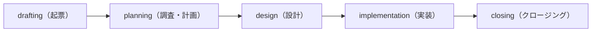
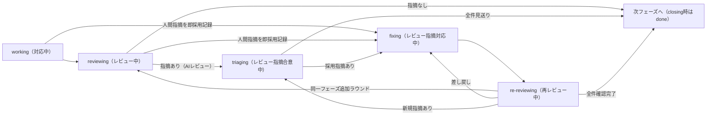

# 03. ワークフロー仕様

## 概要

AIcoにおける作業の進行手順と状態管理を定める。  
本章では以下を定める。

* チケットの状態遷移とフェーズ進行
* レビューと指摘対応のフロー
* 中断と再開の手順

## 1. チケットの状態遷移とフェーズ進行

### 1.1. 3軸による状態管理

チケットの進捗は、以下の直交する3軸を `index.md` の YAML frontmatter で管理する。

| 軸（frontmatterキー） | 役割 | 許容値 |
| :--- | :--- | :--- |
| **ライフサイクル状態（`status`）** | 一覧・ダッシュボード集計用の大区分 | ・`open`（起票・DoR確認中） ・`in-progress`（進行中） ・`done`（完了） ・`cancelled`（中止） |
| **フェーズ（`phase`）** | 現在の作業工程 | ・`drafting`（起票） ・`planning`（調査・計画） ・`design`（設計） ・`implementation`（実装） ・`closing`（クロージング） |
| **フェーズ内状態（`phase_status`）** | 当該フェーズ内での作業・レビュー状態 | ・`working`（対応中） ・`reviewing`（レビュー中） ・`triaging`（レビュー指摘合意中） ・`fixing`（レビュー指摘対応中） ・`re-reviewing`（再レビュー中） ・`done`（完了） |

### 1.2. フェーズの定義と進行

チケットは原則として以下の5フェーズを順に進行する。  
設計を伴わない調査・小修正など、一部フェーズの実作業が不要な場合は、人とAIの合意のうえで該当フェーズをスキップして次フェーズへ進めてよい。

| フェーズ（`phase`） | 主な `status` | 主な実施内容と成果物 | 次フェーズへ進む条件 |
| :--- | :--- | :--- | :--- |
| **`drafting`**（起票） | `open` | チケット起票、概要・AC・DoR（任せる範囲・未決事項）の整理、作業ブランチ名決定 | DoRについて人間の着手合意を得て作業ブランチへ切替済み |
| **`planning`**（調査・計画） | `in-progress` | 現状調査（必要時 `notes/`）、合意仕様・ステップ一覧・検証方針の `plan.md` 記載 | 計画とステップについて人間と合意済み（必要時は計画レビュー完了） |
| **`design`**（設計） | `in-progress` | システム設計書・仕様書の作成または更新、重要な設計判断のADR化 | 設計内容の合意済み（必要時は設計レビュー完了） |
| **`implementation`**（実装） | `in-progress` | 実装、テスト・検証（必要時 `artifacts/` へエビデンス格納）、`plan.md` のチェック更新 | ACに対する実装・検証および必要な実装レビューが完了 |
| **`closing`**（クロージング） | `in-progress` → `done` | `## 変更ファイル` のスクリプト更新、DoD確認、未検証項目の人間判断、`status` 更新、統合 | DoD確認・人間承認を得て `phase_status: done`・`status: done` へ更新し統合済み |

チケット終了時（正常クローズおよび中止）の3軸の最終値は、以下のとおり定める。

| 終了パターン | `status` | `phase` | `phase_status` | 備考 |
| :--- | :--- | :--- | :--- | :--- |
| **正常クローズ** | `done` | `closing` | `done` | クロージング完了として一意に確定する |
| **中止** | `cancelled` | `<中止時点のフェーズ>` | `<中止時点のフェーズ内状態>` | どの工程・状態で止まったかの履歴を維持し、`index.md` に中止理由を記録する |

### 1.3. フェーズ内状態（`phase_status`）の遷移

各フェーズは `working` から開始する。  
レビューを実施しないフェーズでは `working` のまま完了して次フェーズへ進み、レビューを実施するフェーズでは以下のループを回る。  
最終フェーズ（`closing`）の完了承認時に `phase_status` を `done`（あわせて `status: done`）へ更新する。

※調査・評価専用チケットで設計および実装を省略して完了する場合は、`planning` から直接 `closing` への遷移も正規遷移として許可する。

### 1.4. 相談・ADR・Runbook との接続

* **相談（議事録）→ チケット**：相談で目的と任せる仕事が具体化したら、議事録の `tickets` とチケットの `discussions` を相互に紐づけて起票する。
* **ADR との接続**：複数作業へ影響する設計判断が生じた場合は、フェーズに関わらずADRを作成し、チケットの `adrs` とADRの `tickets` を紐づける。
* **Runbook 実施記録 → 相談／チケット**：定常作業の実施中に課題が見つかった場合は、実施記録の `followups` に引き継ぎ先の議事録IDまたはチケットIDを記録する。
* **成果物（`artifacts/`）の扱い**：テストエビデンス・実行ログ・スクリーンショットなどチケット対応に閉じた成果物が必要な場合は、チケット直下の任意フォルダ `artifacts/` へ格納する。内部の命名・構成は導入先プロジェクトの運用に委ねる。

## 2. レビューと指摘対応のフロー

### 2.1. レビュー実施フェーズの決定

どのフェーズ（例：`planning`・`design`・`implementation`）でレビューを実施するかは固定せず、導入先プロジェクトの規約（`AGENTS.md` マーカー外等）またはチケット着手・進行時の都度の合意で決定する。  
いずれのフェーズで実施する場合も、以下の共通フローと記録形式を使用する。

### 2.2. 独立レビューの実施と記録

1. チケットの `phase_status` を `reviewing` へ更新する。
2. 実装・作成を担当したセッションとは独立したコンテキスト（別セッションまたはサブエージェントワーカー）で、対象成果物・仕様・AC・比較基点差分をレビューする。
3. 検出した指摘は1件につき1ファイル、`review/findings/<phase>-round<N>-<NNN>-<slug>.md` として作成する（初期状態は `status: open`）。連番 `NNN` はラウンドごとに `001` から採番する。
4. `review/index.md` の `## レビュー実施記録` に、フェーズ・ラウンド・種別（初回レビュー／再レビュー）・日時・比較基点コミット・実施者・実行環境・未確認事項を追記し、スクリプトで `## 指摘一覧` を再生成する。

### 2.3. 人間選別・修正・独立再確認

1. **採否選別（`triaging`）**：AIが指摘一覧と推奨判断を提示し、**必ず人間が**各指摘の採否を決定する。AIは独断で採否を決定してはならない。
   * 採用する指摘：`status: in-progress` へ更新し、`## 採否判断（人間選別）` に判断理由を記録する。
   * 見送る指摘：`status: cancelled` へ更新し、見送り理由を記録する。
2. **修正対応（`fixing`）**：採用した指摘をすべて修正し、各指摘ファイルの `## 修正内容` に修正概要と関連コミットを記録する。
3. **独立再確認（`re-reviewing`）**：独立コンテキストで修正内容を実物照合し、各指摘ファイルの `## 独立再確認結果` に結果・実行環境・未確認事項を記録する。
   * 問題が解消した指摘：`status: done` へ更新する。
   * 修正不十分な指摘：`status: in-progress` のまま差し戻し理由を追記し、`phase_status` を `fixing` へ戻す。
   * 再確認中に新たな問題を発見した場合：同一フェーズの次ラウンド（`round<N+1>`）として新規指摘ファイルを作成し、`phase_status` を `triaging` へ戻して人間選別を行う。
4. `review/index.md` の実施記録を更新し、スクリプトで指摘一覧を再生成する。当該フェーズの未解決指摘（`open` / `in-progress`）が0件になればレビュー完了とし、次フェーズへ進む（同一フェーズ内で別レビュアーによる追加ラウンドを行う場合は `re-reviewing` → `reviewing` へ遷移して次ラウンドを実施する）。

### 2.4. 人間レビュー指摘の記録と即採用フロー

人間が作業中またはレビュー時に直接指摘を挙げた場合は、AI 独立レビューの `open` → `triaging` 往復を省き、以下の簡略フローで記録・対応できる。

1. `aico-review` の人間レビューモードで指摘ファイルを `status: in-progress`（最初から採用済み、`reviewer: human` 等）で作成し、`record_review_run.py`・`rebuild_indexes.py --scope reviews` で記録する（人間が後から選別したい場合は `status: open` で記録し `triaging` へ進めてもよい）。
2. チケットの `phase_status` を `working` または `reviewing` から直接 `fixing` へ更新し、`aico-review-fix` で修正対応を進める。
3. 修正完了後、人間による確認または独立ワーカーによる追加レビュー（次ラウンド `reviewing`）で解消を確認する。

## 3. 中断と再開の手順

### 3.1. 中断時の記録義務

セッションを中断する際は、別セッションから正確に再開できるよう以下を最新の状態に保ってコミット（または作業ツリーへ保存）すること。

* `index.md` の `phase`・`phase_status` および `## 現在地`（ブロッカー・確認待ち・次に取る行動）
* `plan.md` の `## ステップ一覧`（完了済み `- [x]`・未完了 `- [ ]`）および `## 判断ログ`

### 3.2. 再開時の実物照合手順

再開する担当（人またはAI）は、`index.md` の要約だけを鵜呑みにせず、以下の実物を照合してから作業を再開すること。

1. `index.md` の `status`・`phase`・`phase_status`・`## 現在地`
2. `plan.md` の `## ステップ一覧` および `## 判断ログ`
3. `review/index.md` の未対応指摘（`open` / `in-progress`）
4. `git status` および統合ブランチとの `git diff`（実際のファイル変更状況）

## 関連ポリシー

* [04. プロセス定義](../02.policy/04.process-definition.md)
